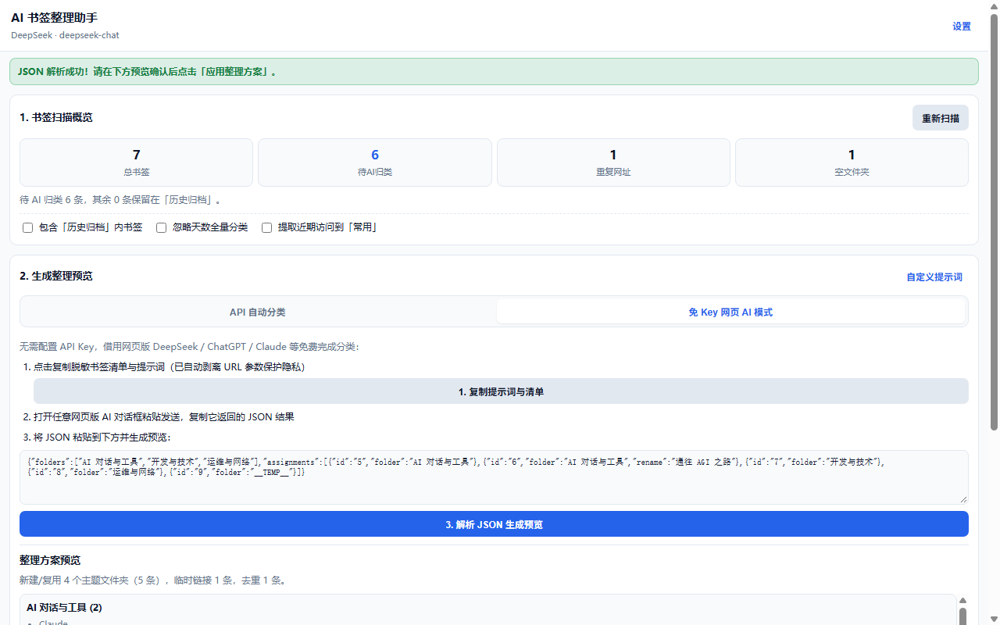
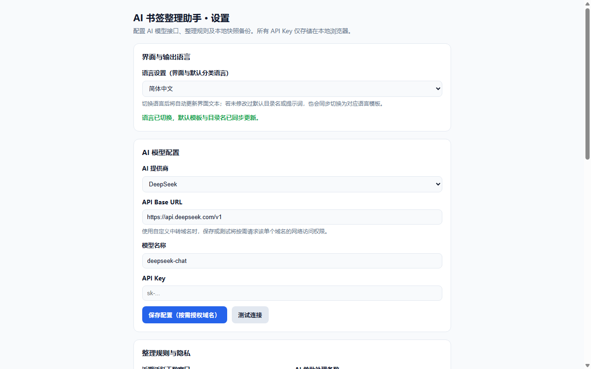

# AI Bookmark Organizer

[English](README.md) | [简体中文](README.zh-CN.md)

A Manifest V3 Chrome extension built with Google Chrome's **Build with AI / Modern Web Guidance (`chrome-extensions` skill)** workflow. Organize messy bookmarks into clean topic folders and a structured historical archive — with privacy-first sanitization, live preview, and one-click snapshot undo.

## Key Features

- **Chrome Sync Safe**: Uses the native `chrome.bookmarks` API directly in the browser, keeping Chrome Sync intact without local/cloud merge conflicts.
- **Recent Categories + History Archive**: Categorizes active/recent bookmarks (plus loose items on the Bookmarks Bar) into clean topic folders, while archiving older bookmarks and isolating one-off/expired links (`__TEMP__`).
- **Flexible Scope Controls**: Quick toggles in the Side Panel to include bookmarks already inside the `Archive` folder, ignore the date cutoff for a full re-organization, or automatically extract recently visited bookmarks (`dateLastUsed`) into a pinned `Frequent` folder.
- **3 AI Modes**:
  1. **Chrome Built-in AI (`LanguageModel` Prompt API)**: Offline, zero setup, zero API cost.
  2. **BYOK Cloud / Local API**: Supports OpenAI, DeepSeek, Alibaba DashScope, SiliconFlow, Anthropic Claude, Google Gemini, local Ollama, and custom OpenAI-compatible endpoints (via runtime `optional_host_permissions`).
  3. **No-Key Web AI Mode**: Follow guided steps `1 → 2 → 3` to copy a sanitized prompt & list for any web AI chat, paste the JSON back, and preview before applying.
- **Custom Prompts & Presets**: Ships with 4 preset prompt templates (Balanced, Minimal Pinned, Developer Stack, Everyday General) and full custom System Prompt editing with one-click reset.
- **Bilingual (`en` / `zh_CN`)**: Supports Chrome `_locales` plus an in-app language switcher (`Auto` / `English` / `简体中文`) that also updates default folder names and prompt templates.
- **Privacy & Snapshot Undo**: Strips URL query parameters and invisible zero-width characters before sending to AI; saves a local snapshot before every apply so you can undo or export JSON anytime.

## Screenshots

| Side Panel (Scan, Scope, Preview, Apply/Undo) | Settings (Language, AI Provider, Rules, Prompts) |
| :---: | :---: |
|  |  |

## Installation

### Option 1: Install from GitHub Releases
1. Download the latest `.zip` from [Releases](https://github.com/huhichao/ai-bookmark-organizer/releases) and extract it.
2. Open `chrome://extensions` in Chrome and enable **Developer mode**.
3. Click **Load unpacked** and select the extracted folder.

### Option 2: Run from Source
```bash
git clone https://github.com/huhichao/ai-bookmark-organizer.git
cd ai-bookmark-organizer

# Run unit & integration tests
npm test

# Run real Chromium E2E verification (requires Playwright Chromium)
npm run test:e2e

# Scan against Chrome Modern Web Guidance rules
npm run scan:mwg

# Build Chrome Web Store ZIP package
npm run package
```

## Project Structure

- `manifest.json` — Manifest V3 manifest with minimal permissions (`bookmarks`, `storage`, `sidePanel`)
- `_locales/` — Chrome native localization bundles (`en`, `zh_CN`)
- `src/background/service-worker.js` — Opens Side Panel on action click without mutable globals
- `src/core/` — Core engine (`analyzer`, `sanitizer`, `ai-client`, `planner`, `applier`, `snapshot`, `i18n`, `permissions`)
- `src/sidepanel/` — Side Panel UI (`Overview → Preview → Apply / Undo`)
- `src/options/` — Settings UI (`Language`, `AI Provider`, `Rules & Prompts`, `Snapshots`)
- `CHROMEWEBSTORE.md` & `PRIVACY.md` — Store listing metadata, permission justifications, and privacy policy

## License

[MIT](LICENSE)
