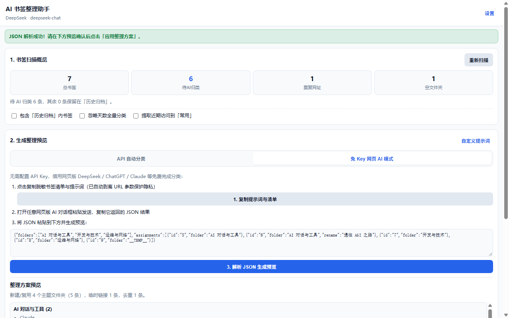
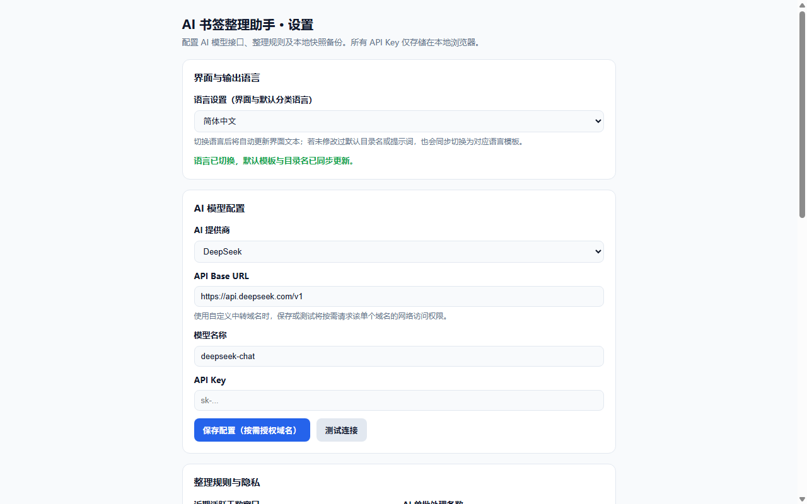

# AI 书签整理助手 (AI Bookmark Organizer)

[English](README.md) | [简体中文](README.zh-CN.md)

基于 Google Chrome 官方 **Build with AI / Modern Web Guidance (`chrome-extensions` skill)** 构建的 Manifest V3 书签整理扩展。将杂乱的浏览器书签按“近期常用 + 历史归档”高效整理清楚，支持隐私脱敏、树状预览与快照一键撤销。

## 核心特性

- **原生同步安全**：直接调用浏览器原生 `chrome.bookmarks` API 操作书签树，完美兼容 Chrome Sync，不会与云端同步产生冲突覆盖。
- **近期分类 + 历史归档**：把近期活跃书签与书签栏散落书签交由 AI 按主题归类；早期旧书签完整移入「历史归档」，一次性/过期链接自动隔离至「临时与一次性链接」。
- **灵活整理范围开关**：侧边栏一键勾选是否包含「历史归档」内书签、是否忽略天数限制全量分类，以及是否按最近点击时间（`dateLastUsed`）自动提取高频书签到置顶「常用」文件夹。
- **三种 AI 模式**：
  1. **Chrome 内置 AI (`LanguageModel` Prompt API)**：零配置、完全离线运行。
  2. **自定义 AI API（BYOK）**：支持 OpenAI、DeepSeek、阿里云百炼、硅基流动、Anthropic Claude、Google Gemini、本地 Ollama 及自定义 OpenAI 兼容接口（自定义域名通过 `optional_host_permissions` 按需动态授权）。
  3. **免 Key 网页 AI 模式**：按界面 **1 → 2 → 3** 步骤引导复制脱敏清单与提示词给网页版 AI，粘回 JSON 即可预览并应用。
- **自定义提示词与预设模板**：内置 4 套分类风格模板（综合主题、极简常用置顶、研发工程向、大众通用），支持自由修改提示词与一键恢复默认。
- **中英双语支持（`zh_CN` / `en`）**：内置 Chrome `_locales` 与应用内实时语言切换（`跟随浏览器` / `简体中文` / `English`），同步切换默认文件夹名与提示词模板。
- **隐私脱敏与一键撤销**：发送给 AI 前自动剥离 URL 查询参数与不可见零宽字符；每次应用前自动保存本地快照，随时一键恢复或导出 JSON 备份。

## 界面预览

| 侧边栏（扫描概览 · 双模式预览 · 应用与撤销） | 设置页（语言切换 · 模型配置 · 规则与提示词） |
| :---: | :---: |
|  |  |

## 安装与使用

### 方式一：下载 Release 安装包
1. 前往 [Releases](https://github.com/huhichao/ai-bookmark-organizer/releases) 下载最新 `.zip` 并解压。
2. 在 Chrome 地址栏打开 `chrome://extensions`，开启右上角 **开发者模式**。
3. 点击 **加载已解压的扩展程序**，选择解压后的目录即可使用。

### 方式二：本地源码开发与测试
```bash
git clone https://github.com/huhichao/ai-bookmark-organizer.git
cd ai-bookmark-organizer

# 运行单元测试与集成测试
npm test

# 运行真实 Chromium 端到端测试（需本机 Playwright Chromium）
npm run test:e2e

# 检查 Chrome Modern Web Guidance 规范兼容性
npm run scan:mwg

# 打包为可提交 Chrome 应用商店的 ZIP
npm run package
```

## 目录结构

- `manifest.json` — Manifest V3 清单（仅申请 `bookmarks`、`storage`、`sidePanel` 最小权限）
- `_locales/` — Chrome 原生国际化语言包（`en`、`zh_CN`）
- `src/background/service-worker.js` — 扩展后台入口（点击图标打开侧边栏，无全局可变状态）
- `src/core/` — 核心引擎（分析、脱敏、AI 客户端、规划校验、应用执行、快照、i18n、权限匹配）
- `src/sidepanel/` — 侧边栏主界面（概览 → 预览 → 应用/撤销）
- `src/options/` — 设置页（语言切换、AI 配置、规则与提示词模板、快照管理）
- `CHROMEWEBSTORE.md` & `PRIVACY.md` — Chrome 应用商店双语上架说明、权限理由与隐私政策

## 开源协议

[MIT](LICENSE)
